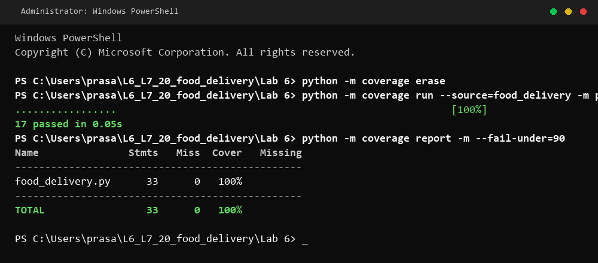
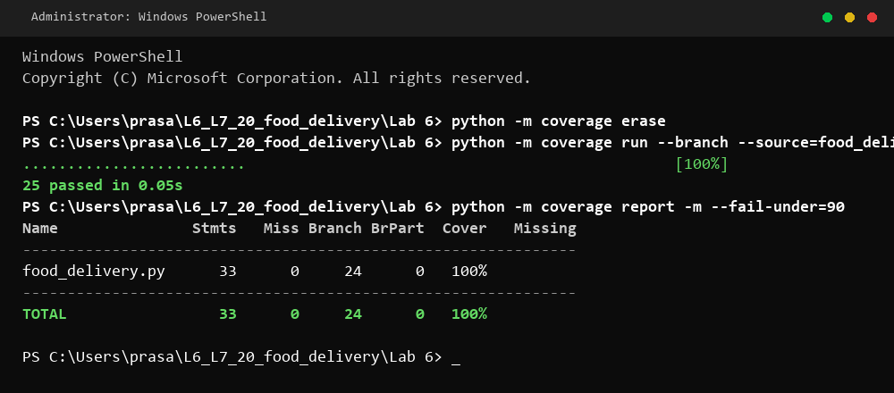

# Lab 6: Code and Branch Coverage Analysis

- **Student:** Prasanna Chidambar Marihalkar
- **SRN:** PES1UG24CS684
- **Application:** Food Delivery
- **Language:** Python
- **Testing framework:** pytest
- **Coverage tool:** coverage.py

---

## Objective

The objective of this lab is to demonstrate the practical difference between statement (line) coverage and branch coverage, use `coverage.py` to inspect execution metrics and untested paths, and design comprehensive test suites that target edge cases, boundary values, and decision branches to achieve at least 90% to 100% test coverage.

---

## Application Overview

The `food_delivery.py` module models a food ordering and dispatch service with three core functions:

1. **`delivery_charge(distance_km, order_value, is_raining)`**
   - Validates that the delivery distance is positive and within the 15 km operating radius (`distance_km <= 0 or distance_km > 15` raises `ValueError`).
   - Grants free standard delivery (`charge = 0`) when `order_value >= 500`.
   - Computes distance-based fees for orders below ₹500:
     - Up to 3 km: ₹20
     - 3 km to 8 km: ₹40
     - Above 8 km (up to 15 km): ₹60
   - Applies an additional ₹30 surcharge when weather condition `is_raining` is true.

2. **`apply_coupon(order_value, code, is_first_order)`**
   - Returns the unmodified `order_value` when no coupon code is supplied (`code is None`).
   - Validates coupon existence against supported coupons (`SAVE50`, `WELCOME`), raising `ValueError` for unknown codes.
   - Enforces first-order eligibility for `WELCOME` (raising `ValueError` if used by repeat customers).
   - Validates minimum order value requirement: orders below ₹200 cannot claim coupon discounts and return `order_value`.
   - Deducts the applicable discount value for qualifying orders.

3. **`estimated_time(distance_km, is_peak_hour, restaurant_busy)`**
   - Calculates base delivery estimate: `15 + distance_km * 4` minutes.
   - Adds 10 minutes during peak hours (`is_peak_hour`).
   - Adds 15 minutes when the restaurant is busy (`restaurant_busy`), plus an additional 5 minutes if both peak hour and busy conditions occur simultaneously.

---

## Test Suites

The test architecture separates code coverage verification from exhaustive branch coverage:

1. **`test_food_delivery.py` (Starter Test Suite)**
   - Initial starter tests provided with the assignment.
   - Retained for baseline analysis and regression testing.

2. **`CodeCoverageTest_PES1UG24CS684_food_delivery.py` (Code Coverage Suite)**
   - Specifically targets line/statement execution across all three application functions.
   - Exercises boundary thresholds (e.g., distances 0, -1, 3, 8, 15, 15.1 km, order amounts around ₹200 and ₹500, raining and dry conditions).
   - Verifies exception paths (`pytest.raises(ValueError)`) for out-of-range delivery distances, invalid coupon codes, and repeat customer use of the `WELCOME` coupon.
   - Exercises all 33 executable statements, achieving **100% statement coverage**.

3. **`BranchCoverageTest_PES1UG24CS684_food_delivery.py` (Branch Coverage Suite)**
   - Exercises every decision branch ($2^n$ logic outcomes) across compound boolean conditions, `if/elif/else` ladders, and nested conditionals:
     - `distance_km <= 0` vs `distance_km > 15` vs valid range.
     - `order_value >= 500` (True/False) evaluated with both `is_raining=True` and `is_raining=False`.
     - Distance tiers: `<= 3 km`, `3 < km <= 8`, and `> 8 km`.
     - Coupon branches: `code is None`, invalid code, `WELCOME` first order, `WELCOME` repeat order, order value `< 200` vs `>= 200`.
     - Estimated time decision matrix: all 4 permutations of `(is_peak_hour, restaurant_busy)` to test the outer and nested branches.
   - Exercises all 24 branch decisions, achieving **100% branch coverage**.

---

## Commands Used

All commands are executed inside the `Lab6` directory. `coverage erase` is run prior to each suite to prevent cross-run data contamination.

### Code Coverage (Statement Coverage)
```powershell
python -m coverage erase
python -m coverage run --source=food_delivery -m pytest -q CodeCoverageTest_PES1UG24CS684_food_delivery.py
python -m coverage report -m --fail-under=90
```

### Branch Coverage
```powershell
python -m coverage erase
python -m coverage run --branch --source=food_delivery -m pytest -q BranchCoverageTest_PES1UG24CS684_food_delivery.py
python -m coverage report -m --fail-under=90
```

### Full Regression Check
```powershell
python -m pytest -q test_food_delivery.py CodeCoverageTest_PES1UG24CS684_food_delivery.py BranchCoverageTest_PES1UG24CS684_food_delivery.py
```

---

## Results

| Test Run | Verified Output / Status |
|---|---|
| Starter suite (`test_food_delivery.py`) | **2 passed** |
| Code coverage suite (`CodeCoverageTest_PES1UG24CS684_food_delivery.py`) | **17 passed** |
| Branch coverage suite (`BranchCoverageTest_PES1UG24CS684_food_delivery.py`) | **25 passed** |
| Combined regression check (all suites) | **44 passed** |
| Statement coverage | **100%** (33 statements, 0 missing) |
| Branch coverage | **100%** (24 branches, 0 partial branches) |

---

## Screenshot Evidence

### Code Coverage Evidence


### Branch Coverage Evidence


---

## Learning and Conclusion

- **Line Coverage vs Branch Coverage:** Line coverage measures whether individual statements were executed at least once, but it can create a false sense of security when boolean decisions or compound clauses only evaluate in one direction. Branch coverage ensures that every conditional predicate is exercised along both `True` and `False` trajectories.
- **Boundary & Decision Testing:** Rigorous boundary testing (such as distance limits and coupon thresholds) exposed the critical branches in conditional pricing and discounting.
- **Test Completeness:** Achieving 100% statement and branch coverage confirms that all implemented paths are tested, though coverage alone does not replace validating expected logical domain rules.

---

## Commits

The following commits record the Lab 6 implementation in this repository:

- `PENDING_COMMIT_1`: `test: add Lab 6 code coverage analysis`
- `PENDING_COMMIT_2`: `test: add Lab 6 branch coverage analysis`
- `PENDING_COMMIT_3`: `docs: update Lab 6 README with verified commit hashes`
