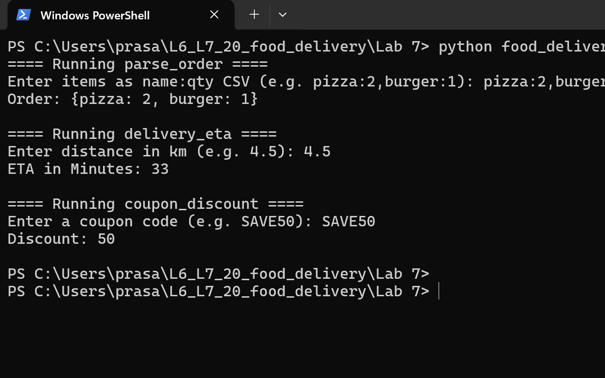
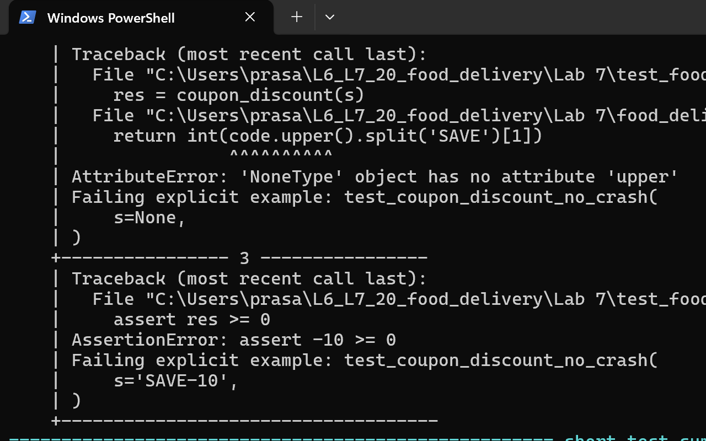
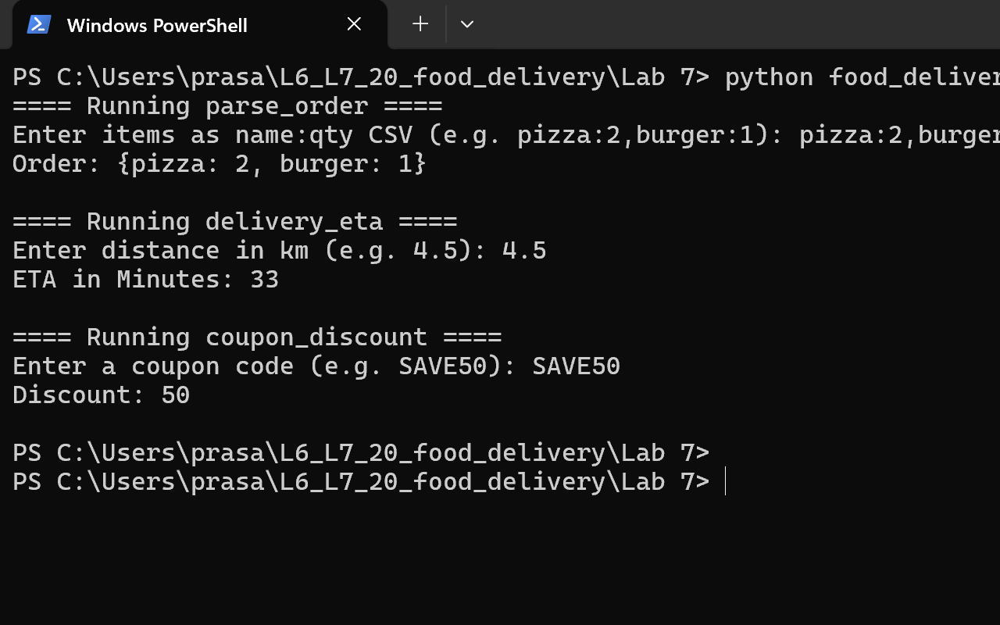
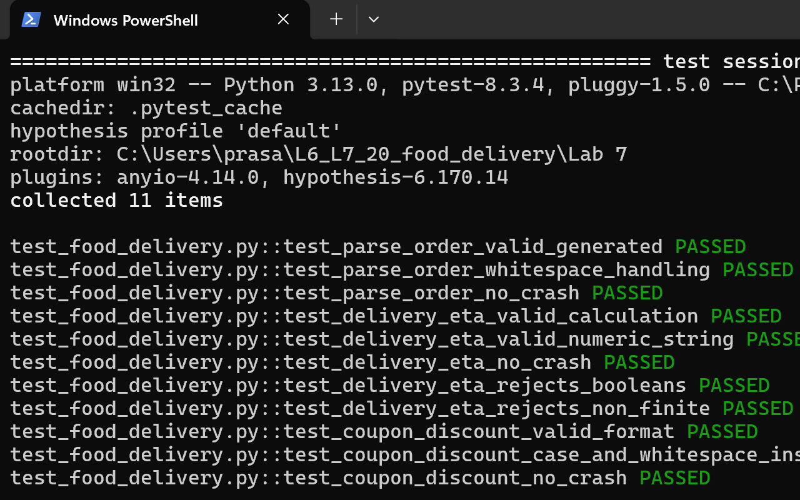

# LAB 7: Fuzzing for Input Validation Bugs

**Student Name:** PRASANNA CHIDAMBAR MARIHALKAR  
**SRN:** PES1UG24CS684  
**Course:** Software Engineering Lab (SE Lab)  
**Assigned Repository:** [SETAPESU26/L6_L7_20_food_delivery](https://github.com/SETAPESU26/L6_L7_20_food_delivery)  
**Assigned Application:** Food Delivery (`food_delivery.py`)  
**Testing Frameworks:** Python 3.8+ / `pytest` / `Hypothesis`

[Download Lab 7 Fuzz Testing Evidence PDF](Lab7_FuzzTesting_Evidence.pdf)

---

## 1. Objective

The primary objective of this laboratory is to apply **property-based fuzz testing** using Python's `Hypothesis` library to uncover subtle edge-case bugs, type errors, boundary conditions, and unhandled runtime exceptions in an assigned application (`food_delivery.py`). Upon exposing these vulnerabilities with reproducible counterexamples, the application is systematically hardened with defensive input validation contracts, and re-tested to verify complete bug resolution and regression prevention.

---

## 2. What is Fuzz Testing?

**Fuzz testing (fuzzing)** is an automated software testing technique that provides invalid, unexpected, malformed, or random data as inputs to a computer program. The program is then monitored for exceptions such as crashes, failing built-in code assertions, infinite loops, or memory leaks.

Unlike traditional unit tests—which test only hand-picked happy path scenarios or obvious edge cases—fuzz testing automatically explores massive input domains, uncovering blind spots and unhandled assumptions that developers frequently overlook.

---

## 3. What Hypothesis Does

`Hypothesis` is a modern, property-based testing library for Python. Rather than requiring developers to write individual unit tests for specific inputs, Hypothesis allows engineers to define:

1. **Input Strategies (`hypothesis.strategies`):** Specifications for the shapes and domains of input data (e.g., text, integers, floats, dictionaries, custom objects).
2. **Properties:** General invariants that must hold true for *any* valid input (e.g., "for any valid dictionary, serializing to CSV and parsing back reconstructs the dictionary").
3. **Automated Falsification & Shrinking:** When Hypothesis finds an input that violates an assertion or triggers an unexpected exception, it systematically searches for the *simplest minimal reproducible example* (shrinking) to present to the developer.

---

## 4. Application Overview

The assigned application is a command-line food delivery processing utility containing three core functions and an interactive `main()` entrypoint:

1. `parse_order(items_csv)`: Parses a comma-separated list of item orders formatted as `item_name:quantity`.
2. `delivery_eta(distance_km)`: Estimates the delivery time in minutes based on distance in kilometers using the formula: `15 + distance * 4`.
3. `coupon_discount(code)`: Calculates the coupon discount integer from a discount coupon string formatted with prefix `SAVE` followed by an integer amount (e.g., `SAVE50`).

---

## 5. Bugs Discovered During Fuzzing

Running the Hypothesis fuzz test suite against the original, unhardened code revealed severe input validation flaws across all three functions:

| Function | Input Discovered by Hypothesis | Exception / Flaw | Root Cause |
| :--- | :--- | :--- | :--- |
| `parse_order` | `None` | `AttributeError: 'NoneType' object has no attribute 'split'` | No type checking on input parameter |
| `parse_order` | `""` (empty string) | `ValueError: not enough values to unpack (expected 2, got 1)` | `item.split(':')` fails when colon separator is absent |
| `parse_order` | `"pizza:"` | `ValueError: invalid literal for int() with base 10: ''` | Missing quantity token after colon |
| `parse_order` | `"pizza:-5"`, `"pizza:0"` | Silent acceptance of non-positive quantities | No business logic check for positive integer count |
| `parse_order` | `"pizza:1,pizza:2"` | Overwrites earlier order entries | No duplicate item detection |
| `delivery_eta` | `None` | `TypeError: float() argument must be a string or a real number, not 'NoneType'` | Missing null validation |
| `delivery_eta` | `False` / `True` | Silently treats boolean as `0.0` or `1.0` km (`ETA: 15` / `19`) | In Python, `bool` is a subclass of `int` |
| `delivery_eta` | `float('inf')` | `OverflowError: cannot convert float infinity to integer` | Inability to convert non-finite float to `int` |
| `delivery_eta` | `-10.5` | Computes nonsensical negative ETA | Missing non-negative distance validation |
| `coupon_discount` | `None` | `AttributeError: 'NoneType' object has no attribute 'upper'` | Missing null validation |
| `coupon_discount` | `""`, `"DISCOUNT50"` | `IndexError: list index out of range` | `code.split('SAVE')[1]` assumes `'SAVE'` is present |
| `coupon_discount` | `"SAVE-10"` | Returns negative discount `-10` | Suffix parsed as negative int without range check |
| `coupon_discount` | `"MYSAVE50EXTRA"` | Silently accepts `'50EXTRA'` substring | Does not validate prefix boundary or suffix composition |

---

## 6. Fixes Applied

All three functions were hardened with defensive programming contracts using Python's standard library:

1. **`parse_order(items_csv)`**:
   - Enforces string type (`isinstance(items_csv, str)`).
   - Validates that the input is non-empty after trimming.
   - Requires every item to strictly contain a single `:` separator separating a non-empty name and integer quantity.
   - Enforces positive quantities (`qty > 0`).
   - Disallows duplicate item names to avoid ambiguity.
   - Raises informative, clean `ValueError` exceptions for all invalid inputs.

2. **`delivery_eta(distance_km)`**:
   - Explicitly rejects `None` and `bool` instances.
   - Validates numeric convertibility to `float`.
   - Rejects non-finite values (`math.isnan` and `math.isinf`) with descriptive `ValueError`.
   - Enforces non-negative distances (`dist >= 0`).
   - Preserves exact original calculation: `int(15 + dist * 4)`.

3. **`coupon_discount(code)`**:
   - Enforces string type.
   - Trims whitespace and normalizes case to uppercase.
   - Requires the coupon to start strictly with prefix `SAVE`.
   - Requires the remaining suffix to be non-empty and digits-only (`discount_str.isdigit()`).
   - Returns the non-negative integer discount or raises `ValueError`.

4. **`main()`**:
   - Wrapped user input operations with `try-except ValueError` blocks to present user-friendly error messages rather than unhandled tracebacks.

---

## 7. Hypothesis Strategies Used

The test suite in `test_food_delivery.py` utilizes comprehensive Hypothesis strategies:

- `st.text() | st.none()`: Arbitrary text fuzzing combined with null values to test resilience against unpredictable input.
- `st.dictionaries(keys=valid_item_name, values=valid_qty)`: Property-based generation of realistic orders to verify round-trip serialization and deserialization.
- `st.floats(min_value=0.0, max_value=10000.0)` and `st.integers(min_value=0, max_value=10000)`: Generation of valid distance domains for calculation verification.
- `st.sampled_from([float('nan'), float('inf'), float('-inf')])`: Targeted edge cases verifying rejection of non-finite floating point numbers.
- `st.booleans()`: Ensuring booleans are not inadvertently accepted as numeric distances.
- `st.sampled_from(["save", "Save", "SAVE", "sAvE"])`: Verifying case-insensitivity of coupon prefix handling.
- `@example(...)`: Explicit edge-case regression tests (e.g. empty strings, whitespace, delimiters, negative values).

---

## 8. Before-and-After Test Results

### Before Hardening (Original Buggy Code)
```text
================================== FAILURES ===================================
FAILED test_food_delivery.py::test_parse_order_no_crash
FAILED test_food_delivery.py::test_delivery_eta_no_crash
FAILED test_food_delivery.py::test_delivery_eta_rejects_booleans
FAILED test_food_delivery.py::test_delivery_eta_rejects_non_finite
FAILED test_food_delivery.py::test_coupon_discount_no_crash
========================= 5 failed, 6 passed in 4.79s =========================
```

### After Hardening (Fixed Code)
```text
============================= test session starts =============================
test_food_delivery.py::test_parse_order_valid_generated PASSED           [  9%]
test_food_delivery.py::test_parse_order_whitespace_handling PASSED       [ 18%]
test_food_delivery.py::test_parse_order_no_crash PASSED                  [ 27%]
test_food_delivery.py::test_delivery_eta_valid_calculation PASSED        [ 36%]
test_food_delivery.py::test_delivery_eta_valid_numeric_string PASSED     [ 45%]
test_food_delivery.py::test_delivery_eta_no_crash PASSED                 [ 54%]
test_food_delivery.py::test_delivery_eta_rejects_booleans PASSED         [ 63%]
test_food_delivery.py::test_delivery_eta_rejects_non_finite PASSED       [ 72%]
test_food_delivery.py::test_coupon_discount_valid_format PASSED          [ 81%]
test_food_delivery.py::test_coupon_discount_case_and_whitespace_insensitivity PASSED [ 90%]
test_food_delivery.py::test_coupon_discount_no_crash PASSED              [100%]

============================= 11 passed in 1.10s ==============================
```

---

## 9. Reproducible Commands

### Install Dependencies
```powershell
python -m pip install hypothesis pytest
```

### Run the Application
```powershell
python food_delivery.py
```

### Execute the Hypothesis Fuzz Test Suite
```powershell
python -m pytest -vv test_food_delivery.py
```

---

## 10. Screenshot Evidence

### Original Application


### Hypothesis-Discovered Failures


### Fixed Application


### Successful Fuzz Tests


---

## 11. PDF Evidence Document

The compiled PDF document containing genuine terminal screenshots, captions, and summaries is available at:
[Download Lab 7 Fuzz Testing Evidence PDF](Lab7_FuzzTesting_Evidence.pdf)

---

## 12. Conclusion and Learning Outcomes

1. **Effectiveness of Property-Based Fuzzing:** Hypothesis uncovered critical blind spots (IndexError, AttributeError, OverflowError, boolean type coercion) that standard manual tests frequently miss.
2. **Contract-Based Defensive Programming:** Establishing clear input validation contracts converting unexpected crashes into structured `ValueError` exceptions greatly enhances application robustness.
3. **Regression Prevention:** Writing property-based tests ensures that future code modifications preserve valid input handling while strictly enforcing input boundary invariants.
